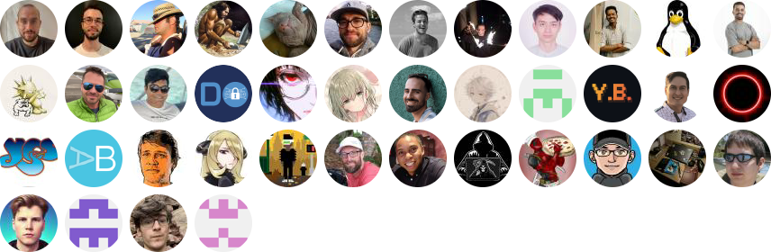

<h1 align="center">
  <picture>
    <source media="(prefers-color-scheme: dark)" srcset="docs/brand/wordmark-dark.svg">
    
  </picture>
</h1>

<p align="center"><b>The fastest developer workflow for every AI coding agent.</b></p>

<p align="center">agent manager is a local terminal app that connects to your existing subscriptions and tools.</p>

<p align="center">
  English · <a href="README.zh-CN.md">简体中文</a> · <a href="README.ja.md">日本語</a>
</p>

<p align="center">
  <a href="https://peerlist.io/yoanwai/project/agent-manager" target="_blank" rel="noopener noreferrer">
    <picture>
      <source media="(prefers-color-scheme: dark)" srcset="docs/brand/peerlist-laurel-dark.webp">
      
    </picture>
  </a>
</p>

<p align="center">
  <a href="https://trendshift.io/repositories/89312?utm_source=trendshift-badge&amp;utm_medium=badge&amp;utm_campaign=badge-trendshift-89312" target="_blank" rel="noopener noreferrer"></a>
  <a href="https://www.producthunt.com/products/agent-manager?utm_source=badge-featured&amp;utm_medium=badge" target="_blank" rel="noopener noreferrer"></a>
</p>

<p align="center">
  <a href="https://github.com/wainmann/agent-manager/stargazers"></a>
  <a href="https://github.com/wainmann/agent-manager"></a>
  <a href="https://github.com/wainmann/agent-manager/releases/latest"></a>
  <a href="https://discord.gg/ecS88An7pF"></a>
  <a href="https://github.com/sponsors/YoanWai"></a>
  <br>
  <a href="https://github.com/wainmann/agent-manager/actions/workflows/ci.yml"></a>
  <a href="https://app.codecov.io/gh/wainmann/agent-manager"></a>
  <a href="https://pkg.go.dev/github.com/YoanWai/agent-manager"></a>
  <a href="LICENSE"></a>
</p>


Claude Code, Codex, OpenCode, Grok, Gemini CLI, Antigravity CLI, Pi, Command Code, Hermes Agent, Muse Code, Oh My Pi, Cursor CLI, Kiro CLI, and GitHub Copilot CLI run side by side. Each tool runs in its own persistent tmux session.

agent-manager is a thin layer over the CLIs you already have. Each session launches your own installed tool as-is: your login, your subscription, your config files, your MCP servers, and every feature the tool ships all carry over, exactly as they behave in a plain terminal.

Instead of hunting through terminal tabs to see which agent is done and which is stuck, every session shows up in one list with live status, grouped into a project tree you can fold and reorder. You answer any of them without attaching: `space` sends a prompt straight into a session's pane, or spawns a new agent in the selected group. A dead session revives on its own conversation with `v`. And `ctrl+r` opens a full-file diff of what an agent changed, syntax-highlighted, where the comments you leave on lines go back to the agent's pane as one review prompt when you press `C`.

Press `f` on a session to continue its conversation in a separate named fork.

The mouse works across the whole manager. The wheel moves the cursor, a click on a session focuses it, and a click on its row or the mouse back button brings you back. Drag a row by its handle (`⠿` in Advanced, `=` in Compatible) to reorder it or move it into another group, and the `[…]` at the end of every row opens its actions. The divider between the list and the preview drags, and while any message is left, a click on `messages` in the key legend opens it. In a focused pane a drag selects and copies text, and a click on a link opens it in your browser. Settings has a mouse toggle for terminals where you want native selection back. Settings → **symbols** switches between **Advanced** geometric marks (the default) and **Compatible** ASCII marks, with a live preview.

![Mouse demo with the geometric marks used by Advanced mode: the wheel moves the cursor, clicks focus and leave sessions, the ⠿ handle drags rows, and […] opens row actions](docs/demo-mouse.gif)

The tools you use alongside agents live in the same list: `T` opens a shell under the selected agent, or in the selected group, for builds, Git, and one-off commands. An agent can spawn another, send it a message, and wait until it is done: every MCP-capable session carries those tools on launch.

Save named instructions in Settings and reuse them from the New Session form, the quick prompt, a focused session, `spawn --saved`, `send --saved`, or `create_session`. See [Saved prompts](docs/usage.md#saved-prompts).

Not here yet: cost tracking.

**Jump to:** [Install](#install) · [Usage](#usage) · [Keys](docs/usage.md#keys) · [Diff review](docs/usage.md#diff-review) · [Configuration](docs/configuration.md) · [Docs site](https://agent-manager.dev/docs/)

## Supported tools

Status detection supports **Claude Code**, **OpenCode**, **Codex**, **Grok Build**, **Gemini CLI**, **Antigravity CLI**, **Pi**, **Command Code**, **Hermes Agent**, **Muse Code**, **Oh My Pi**, **Cursor CLI**, **Kiro CLI**, and **GitHub Copilot CLI**. Each one's launch, revive, fork, and status rules ship in the binary (Hermes, Antigravity, Oh My Pi, Cursor CLI, Kiro CLI, and GitHub Copilot CLI have no fork), so an upgrade brings the current version of all of them (see [Configuration](docs/configuration.md#agent-clis)). A CLI that is not on the list is a [feature request](https://github.com/wainmann/agent-manager/issues/new/choose).

## Install

Runs on macOS, Linux, Windows (with [psmux](docs/install.md#windows)) and WSL2.

```bash
brew install agent-manager                         # Homebrew (macOS / Linux)
brew install --cask yoanwai/tap/agent-manager      # Homebrew cask, prebuilt binary
yay -S agent-manager-bin                           # Arch Linux (AUR)
mise use -g github:wainmann/agent-manager          # mise
go install github.com/YoanWai/agent-manager@latest # Go
```

```bash
# install script (macOS / Linux / WSL2)
curl -fsSL https://github.com/wainmann/agent-manager/releases/latest/download/install.sh | sh
```

```powershell
# install script (Windows)
irm https://github.com/wainmann/agent-manager/releases/latest/download/install.ps1 | iex
```

```powershell
# Scoop (Windows)
scoop bucket add yoanwai https://github.com/YoanWai/scoop-bucket
scoop install yoanwai/agent-manager
```

Prebuilt binaries for every platform are on [Releases](https://github.com/wainmann/agent-manager/releases). [docs/install.md](docs/install.md) covers dependencies, checking a download, updating and uninstalling.

## Usage

```bash
agent-manager
```

Sessions run inside tmux (`am_*` namespace), so they survive the manager quitting. Inside a session, **Ctrl+Q** detaches back to the manager when your terminal and tmux leave it available; **Ctrl+\\** is an alternate under the same rule. **Ctrl+C** reaches the agent as its cancel key while a session is focused, so an interrupted prompt leaves the manager running. **Ctrl+R** opens the session's diff review and **F3** opens its directory in your editor; the **keybindings** row in Settings (`s`) moves any of them, or hands one back to the agent, and moves or turns off any action of the manager's own list, with `esc` and `ctrl+c` staying as they are (see [Key bindings](docs/configuration.md#key-bindings)). In a full-screen attach, the session footer also shows an inner tmux prefix followed by `d` when configured. When nested inside another tmux, send the inner prefix shown in the footer, then press `d`. If both tmux servers use the same prefix, invoke the outer tmux's `send-prefix` binding; if the outer tmux otherwise captures the inner prefix, configure it to forward that key. `agent-manager --version` prints the version.

Agent sessions live on a private tmux server named `agentmgr`, so they never mix with the tmux you run yourself and a `kill-server` on your own socket leaves them alone. To reach one from a plain shell, name that server: `tmux -L agentmgr ls`, then `tmux -L agentmgr attach -t am_<id>`.

The full reference, every key, quick prompt mode, killing and reviving, diff review, groups, status detection, stats, and themes, lives in [docs/usage.md](docs/usage.md). Tell your agent what you want to review in Agent Manager, and your agent will set it up for you to view in the review panel. You can also tell your agent to manage sessions and terminals in Agent Manager. The short version:

| Key | Action |
|-----|--------|
| `n` | New session (name, tool, the model, effort and profile the tool reports, environment profile, directory, optional starting prompt, group) |
| `space` | Quick prompt mode: answer the selected session, or spawn an agent in the selected group |
| `enter` | Focus the session in place; keys go to the agent while the list stays |
| click / double click | Focus a session from its row or its preview / fold or unfold a group. The full-screen layout selects on a click and focuses on a double click |
| drag `⠿` / `=` | Reorder a row, drop it into another group, or nest a terminal under an agent |
| `[…]` / right click | The row's actions: attach, prompt, review, fork, rename, move, archive, kill, delete and more |
| click the list / mouse back | Focused: back to the list. A click on another row focuses that one |
| `→` / `←` | Step in and out: `→` focuses the session or opens the group, `←` closes the group and, at the start of a focused agent's prompt, comes back to the list. Settings can turn the pair off, or set it to `attach`: `→` then attaches full screen and `←` at the prompt's start comes back from the attach (macOS and Linux hosts) |
| `ctrl+r` | Review the session's changes as full-file diffs; `c` comments a line, `C` sends a numbered review round, and sent comments stay visible as open or handled |
| `x` / `v` | Kill a session to free its RAM / revive it on its own conversation |
| `R` | Restart a session on an empty context: same name, group, directory and tool, fresh conversation |
| `s` | Settings (default tool, theme or follow the OS light/dark mode, list density, mouse, review layout, desktop notifications, editor, keybindings) |
| `?` | The key map for the current screen; review shows only review bindings |

A session can spawn into its own git worktree (`<repo>-worktrees/<name>`, branch `am/<name>`), toggled on the `n` form, with `ctrl+t` in quick prompt mode, or by default in Settings.

A session can start on a model, reasoning effort and profile of its own, picked on the `n` form, with `ctrl+l`, `ctrl+x` and `ctrl+y` in quick prompt mode, or with `spawn --model --effort --profile`. The lists come from each CLI at runtime, so a new model shows up the day the CLI ships it, and restart, revive and fork keep the choice (see [Model, effort and profile](docs/usage.md#model-effort-and-profile)).

A session can also launch under an environment profile, a named set of environment variables such as a second `CLAUDE_CONFIG_DIR`, defined with `agent-manager env set` and picked per session or as a group's default (see [Environment profiles](docs/usage.md#environment-profiles)).


Configuration (Settings, the editor `o` opens, and the key tables) is in [docs/configuration.md](docs/configuration.md).

## Development

```bash
go run .
mkdir -p /tmp/amtest && env -u TMUX TMUX_TMPDIR=/tmp/amtest SHELL=/bin/sh go test -race ./...   # end-to-end tests drive a real tmux server
```

See [CONTRIBUTING.md](.github/CONTRIBUTING.md) for the checks CI runs, and [AGENTS.md](AGENTS.md) if you point a coding agent at this repo.

## Community

Join the [Agent Manager Community](https://discord.gg/ecS88An7pF) on Discord. Ask questions and get setup help in #help, share your setup in #workflows, and talk about contributing in #dev. Bugs and feature requests go in [GitHub issues](https://github.com/wainmann/agent-manager/issues/new/choose).

## Contributing

**Contributors and collaborators wanted.** agent-manager is actively looking for people to help build it. Unassigned issues are free to take, comment on one to claim it, and regular contributors get invited as collaborators. Say hi in #dev on [Discord](https://discord.gg/ecS88An7pF).

Bug reports, feature ideas, and pull requests are welcome. See [CONTRIBUTING.md](.github/CONTRIBUTING.md) for setup and the checks CI runs. Project roles and how decisions are made are in [GOVERNANCE.md](GOVERNANCE.md), with the current roster in [MAINTAINERS.md](MAINTAINERS.md). Questions and setups worth sharing go in [Discussions](https://github.com/wainmann/agent-manager/discussions). Security reports go through a [private advisory](https://github.com/wainmann/agent-manager/security/advisories/new); see [SECURITY.md](.github/SECURITY.md).

### Contributors

<a href="https://github.com/wainmann/agent-manager/graphs/contributors"></a>

## Sponsors

<p align="center">
  <a href="https://github.com/dempc6469">
    
    <br>
    <sub><b>@dempc6469</b></sub>
  </a>
</p>

<p align="center">
  <a href="https://github.com/sponsors/YoanWai"></a>
</p>

## License

[Apache-2.0](LICENSE)

---

<p align="center">
  <a href="https://peerlist.io/yoanwai/project/agent-manager" target="_blank" rel="noopener noreferrer"></a>
  <a href="https://www.producthunt.com/products/agent-manager?utm_source=badge-review&amp;utm_medium=badge" target="_blank" rel="noopener noreferrer"></a>
</p>
