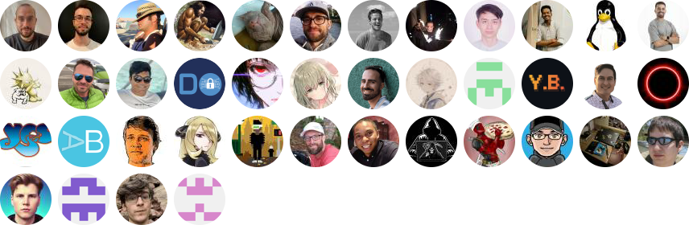

<h1 align="center">
  <picture>
    <source media="(prefers-color-scheme: dark)" srcset="docs/brand/wordmark-dark.svg">
    
  </picture>
</h1>

<p align="center"><b>为每一个 AI 编程智能体打造的最快开发工作流。</b></p>

<p align="center">agent manager 是一个本地终端应用，直接连接你现有的订阅和工具。</p>

<p align="center">
  <a href="README.md">English</a> · 简体中文 · <a href="README.ja.md">日本語</a>
</p>

<p align="center">
  <a href="https://peerlist.io/yoanwai/project/agent-manager" target="_blank" rel="noopener noreferrer">
    <picture>
      <source media="(prefers-color-scheme: dark)" srcset="docs/brand/peerlist-laurel-dark.webp">
      
    </picture>
  </a>
</p>

<p align="center">
  <a href="https://trendshift.io/repositories/89312?utm_source=trendshift-badge&amp;utm_medium=badge&amp;utm_campaign=badge-trendshift-89312" target="_blank" rel="noopener noreferrer"></a>
  <a href="https://www.producthunt.com/products/agent-manager?utm_source=badge-featured&amp;utm_medium=badge" target="_blank" rel="noopener noreferrer"></a>
</p>

<p align="center">
  <a href="https://github.com/wainmann/agent-manager/stargazers"></a>
  <a href="https://github.com/wainmann/agent-manager"></a>
  <a href="https://github.com/wainmann/agent-manager/releases/latest"></a>
  <a href="https://discord.gg/ecS88An7pF"></a>
  <br>
  <a href="https://github.com/wainmann/agent-manager/actions/workflows/ci.yml"></a>
  <a href="https://app.codecov.io/gh/wainmann/agent-manager"></a>
  <a href="https://pkg.go.dev/github.com/YoanWai/agent-manager"></a>
  <a href="LICENSE"></a>
</p>


> 本文是英文 [README](README.md) 的翻译。两者不一致时，以英文版为准。

Claude Code、Codex、OpenCode、Grok、Gemini CLI、Antigravity CLI、Pi、Command Code、Hermes Agent、Muse Code、Oh My Pi 和 Cursor CLI 可以并排运行。每个 CLI 都运行在自己的持久 tmux 会话中。

agent-manager 是你已有 CLI 之上的一层薄壳。每个会话启动的都是你本机安装的原版 CLI：你的登录、订阅、配置文件、MCP 服务器，以及 CLI 自带的所有功能都原样保留，和在普通终端里运行完全一样。

不用再在一堆终端标签页里找哪个智能体做完了、哪个卡住了。所有会话都显示在同一个列表里，带实时状态，并按项目树分组，可以折叠和排序。无需进入会话就能回复任何一个：`space` 把提示词直接发到会话的面板，或在选中的分组里启动一个新智能体。已退出的会话按 `v` 就能在原来的对话上恢复。`ctrl+r` 打开智能体改动的完整文件 diff，带语法高亮。你在代码行上留下的评论，按 `C` 后会合成一条审查提示发回智能体的面板。

在会话上按 `f`，可以把它的对话分叉成一个单独命名的新会话继续。

整个管理器都支持鼠标。滚轮移动光标，单击会话即可聚焦，单击它的行或按鼠标后退键即可返回。拖动行的手柄（Advanced 模式为 `⠿`，Compatible 模式为 `=`）可以排序，或移动到另一个分组。每行末尾的 `[…]` 打开该行的操作菜单。列表和预览之间的分隔线可以拖动。只要还有未读消息，单击按键说明里的 `messages` 就能打开它。在聚焦的面板里，拖动即选中并复制文本，单击链接会在浏览器中打开。设置里有鼠标开关，方便在需要终端原生选择的地方关闭它。设置 → **symbols** 可以在 **Advanced** 几何符号（默认）和 **Compatible** ASCII 符号之间切换，并带实时预览。

![Advanced 模式几何符号下的鼠标演示：滚轮移动光标，单击聚焦和离开会话，拖动 ⠿ 手柄排序，[…] 打开行操作](docs/demo-mouse.gif)

和智能体一起用的工具也在同一个列表里：`t` 在选中的智能体或分组下打开一个 shell，用来构建、跑 Git 和临时命令。智能体可以启动另一个智能体、给它发消息，并等待它完成：每个支持 MCP 的会话在启动时都带有这些工具。

在设置里保存命名的指令，然后在新建会话表单、快速提示、聚焦的会话、`spawn --saved`、`send --saved` 或 `create_session` 中复用。详见 [Saved prompts](docs/usage.md#saved-prompts)。

尚未支持：费用统计。

**跳转到：** [安装](#安装) · [使用](#使用) · [按键](docs/usage.md#keys) · [Diff 审查](docs/usage.md#diff-review) · [配置](docs/configuration.md) · [文档站](https://agent-manager.dev/docs/)

## 支持的 CLI

状态检测支持 **Claude Code**、**OpenCode**、**Codex**、**Grok Build**、**Gemini CLI**、**Antigravity CLI**、**Pi**、**Command Code**、**Hermes Agent**、**Muse Code**、**Oh My Pi** 和 **Cursor CLI**。每个工具的启动、恢复、分叉和状态规则都内置在二进制文件中（Hermes、Antigravity、Oh My Pi 和 Cursor CLI 不支持分叉），所以升级一次就能拿到所有工具的最新规则（见 [Configuration](docs/configuration.md#agent-clis)）。想支持列表外的 CLI，请提交 [功能请求](https://github.com/wainmann/agent-manager/issues/new/choose)。

## 安装

支持 macOS、Linux、Windows（通过 [psmux](docs/install.md#windows)）和 WSL2。

```bash
brew install agent-manager                         # Homebrew（macOS / Linux）
brew install --cask yoanwai/tap/agent-manager      # Homebrew cask，预编译二进制
yay -S agent-manager-bin                           # Arch Linux（AUR）
mise use -g github:wainmann/agent-manager          # mise
go install github.com/YoanWai/agent-manager@latest # Go
```

```bash
# 安装脚本（macOS / Linux / WSL2）
curl -fsSL https://github.com/wainmann/agent-manager/releases/latest/download/install.sh | sh
```

```powershell
# 安装脚本（Windows）
irm https://github.com/wainmann/agent-manager/releases/latest/download/install.ps1 | iex
```

```powershell
# Scoop（Windows）
scoop bucket add yoanwai https://github.com/YoanWai/scoop-bucket
scoop install yoanwai/agent-manager
```

各平台的预编译二进制文件见 [Releases](https://github.com/wainmann/agent-manager/releases)。依赖、校验下载、更新和卸载见 [docs/install.md](docs/install.md)。

## 使用

```bash
agent-manager
```

会话运行在 tmux 里（`am_*` 命名空间），所以退出管理器后它们依然存活。在会话里，只要你的终端和 tmux 没有占用该键，**Ctrl+Q** 就会返回管理器；**Ctrl+\\** 是同样规则下的备用键。会话聚焦时，**Ctrl+C** 作为取消键发给智能体，所以中断提示词不会退出管理器。**Ctrl+R** 打开会话的 diff 审查，**F3** 在编辑器中打开它的目录；设置（`s`）里的 **keybindings** 行可以改动其中任何一个，或把它交还给智能体，也可以改动或关闭管理器自身列表里的任何操作，`esc` 和 `ctrl+c` 保持不变（见 [Key bindings](docs/configuration.md#key-bindings)）。在全屏进入的会话中，配置了内层 tmux 前缀时，会话底栏还会显示该前缀加 `d`。嵌套在另一个 tmux 里时，先发送底栏显示的内层前缀，再按 `d`。如果两个 tmux 服务器用的是同一个前缀，请使用外层 tmux 的 `send-prefix` 绑定；如果外层 tmux 会截获内层前缀，请配置它转发该键。`agent-manager --version` 打印版本号。

智能体会话运行在名为 `agentmgr` 的独立 tmux 服务器上，所以它们不会和你自己运行的 tmux 混在一起，在你自己的 socket 上执行 `kill-server` 也不会影响它们。想从普通 shell 进入某个会话，需要指定这个服务器：先 `tmux -L agentmgr ls`，再 `tmux -L agentmgr attach -t am_<id>`。

完整参考，包括所有按键、快速提示模式、结束和恢复、diff 审查、分组、状态检测、统计和主题，见 [docs/usage.md](docs/usage.md)。告诉你的智能体你想在 Agent Manager 里审查什么，它会帮你设置好，在审查面板里查看。你也可以让智能体在 Agent Manager 里管理会话和终端。简要版本：

| 按键 | 作用 |
|-----|--------|
| `n` | 新建会话（名称、CLI、该 CLI 提供的模型、推理强度和 profile、环境配置、目录、可选的初始提示词、分组） |
| `space` | 快速提示模式：回复选中的会话，或在选中的分组里启动智能体 |
| `enter` | 原地聚焦会话；按键发给智能体，列表保持可见 |
| 单击 / 双击 | 从行或预览聚焦会话 / 折叠或展开分组。全屏布局中单击选中，双击聚焦 |
| 拖动 `⠿` / `=` | 排序、放入另一个分组，或把终端挂到某个智能体下 |
| `[…]` / 右键 | 行操作：进入、提示、审查、分叉、重命名、移动、归档、结束、删除等 |
| 单击列表 / 鼠标后退键 | 聚焦时：返回列表。单击另一行会聚焦那一行 |
| `→` / `←` | 进入和退出：`→` 聚焦会话或展开分组，`←` 折叠分组，或在聚焦智能体的提示词开头处返回列表。可以在设置里关闭这对按键 |
| `ctrl+r` | 以完整文件 diff 审查会话的改动；`c` 评论一行，`C` 发送一轮编号的审查，已发送的评论会保留并显示为未处理或已处理 |
| `x` / `v` | 结束会话以释放内存 / 在原对话上恢复 |
| `R` | 以空上下文重启会话：名称、分组、目录和 CLI 不变，对话重新开始 |
| `s` | 设置（默认 CLI、主题或跟随系统明暗模式、列表密度、鼠标、审查布局、桌面通知、编辑器、按键绑定） |
| `?` | 当前界面的按键表；审查界面只显示审查相关的绑定 |

会话可以在独立的 git worktree 中启动（`<repo>-worktrees/<name>`，分支 `am/<name>`）。在 `n` 表单中切换，快速提示模式中按 `ctrl+t`，或在设置里设为默认。

会话也可以使用自己的模型、推理强度和 profile，在 `n` 表单中选择，快速提示模式中按 `ctrl+l`、`ctrl+x` 和 `ctrl+y`，或使用 `spawn --model --effort --profile`。列表在运行时从各个 CLI 读取，所以 CLI 发布新模型的当天就能用上，重启、恢复和分叉都会保留这些选择（见 [Model, effort and profile](docs/usage.md#model-effort-and-profile)）。

会话还可以在环境配置下启动。环境配置是一组命名的环境变量，例如第二个 `CLAUDE_CONFIG_DIR`，用 `agent-manager env set` 定义，可以按会话选择，也可以设为分组的默认值（见 [Environment profiles](docs/usage.md#environment-profiles)）。


配置（设置、`o` 打开的编辑器和按键表）见 [docs/configuration.md](docs/configuration.md)。

## 开发

```bash
go run .
mkdir -p /tmp/amtest && env -u TMUX TMUX_TMPDIR=/tmp/amtest SHELL=/bin/sh go test -race ./...   # 端到端测试会驱动一个真实的 tmux 服务器
```

CI 运行的检查见 [CONTRIBUTING.md](.github/CONTRIBUTING.md)。如果你让编程智能体处理这个仓库，请让它阅读 [AGENTS.md](AGENTS.md)。

## 社区

加入 Discord 上的 [Agent Manager Community](https://discord.gg/ecS88An7pF)。在 #help 提问和获取安装帮助，在 #workflows 分享你的配置，在 #dev 讨论参与贡献。Bug 和功能请求请提交到 [GitHub issues](https://github.com/wainmann/agent-manager/issues/new/choose)。

## 参与贡献

**欢迎贡献者和协作者。** agent-manager 正在积极寻找一起构建它的人。未被认领的 issue 都可以领取，在 issue 下留言即可认领，长期贡献者会被邀请成为协作者。来 [Discord](https://discord.gg/ecS88An7pF) 的 #dev 打个招呼吧。

欢迎提交 bug 报告、功能想法和 pull request。开发环境和 CI 检查见 [CONTRIBUTING.md](.github/CONTRIBUTING.md)。问题和值得分享的配置请发到 [Discussions](https://github.com/wainmann/agent-manager/discussions)。安全问题请通过 [私密安全公告](https://github.com/wainmann/agent-manager/security/advisories/new) 报告，见 [SECURITY.md](.github/SECURITY.md)。

### 贡献者

<a href="https://github.com/wainmann/agent-manager/graphs/contributors"></a>

## 许可证

[Apache-2.0](LICENSE)

---

<p align="center">
  <a href="https://peerlist.io/yoanwai/project/agent-manager" target="_blank" rel="noopener noreferrer"></a>
  <a href="https://www.producthunt.com/products/agent-manager?utm_source=badge-review&amp;utm_medium=badge" target="_blank" rel="noopener noreferrer"></a>
</p>
